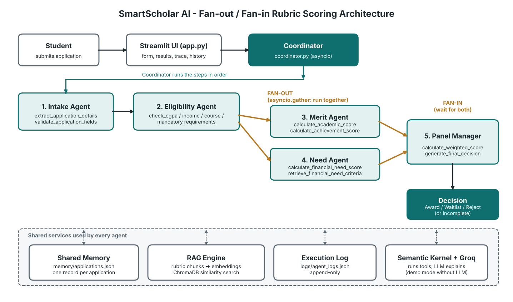
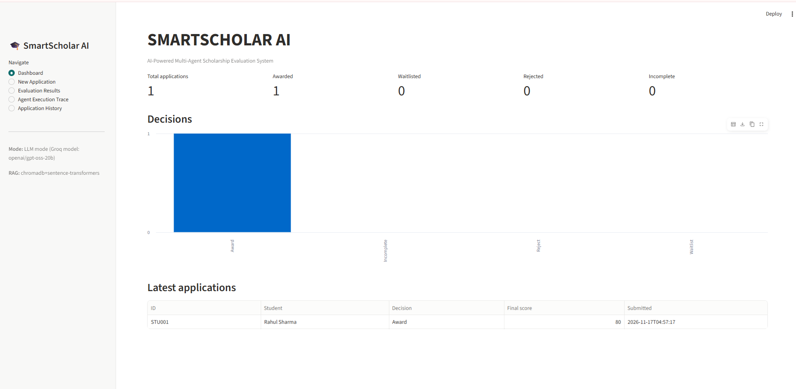
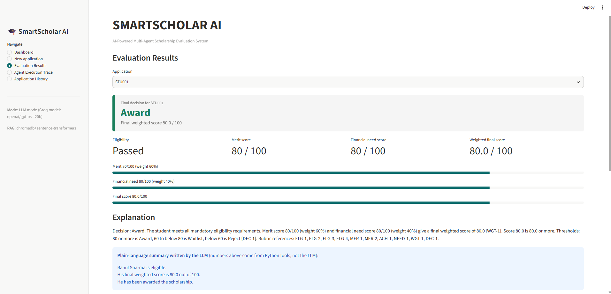
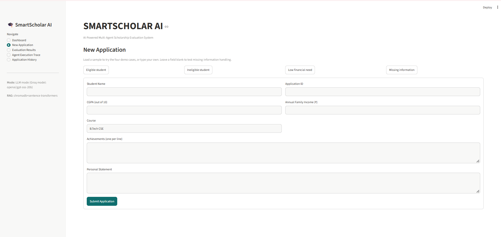
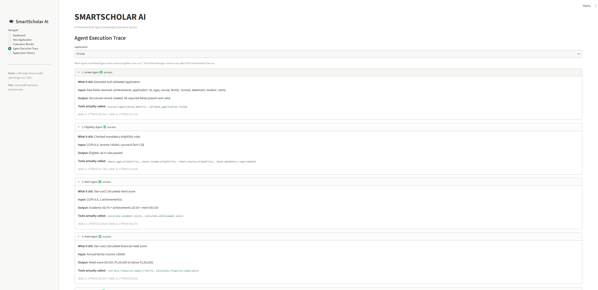
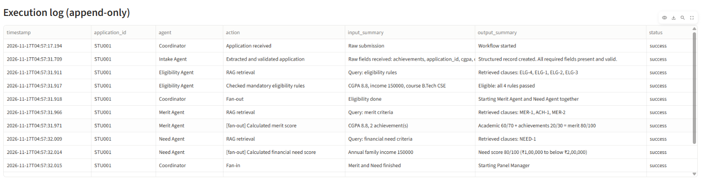

# 🎓 SmartScholar AI
### AI-Powered Multi-Agent Scholarship Evaluation System

**B.Tech CSE – Agentic AI and Intelligent Automation Assignment**

*The rubric in `knowledge_base/` contains sample demonstration data and does not represent a real university scholarship policy.*

---

## 1. Introduction and Objective

SmartScholar AI evaluates student scholarship applications and generates one of three decisions: **Award, Waitlist or Reject**. If required information is missing or invalid, the application is marked **Incomplete – Review Required**.

The system uses five specialised AI agents that collaborate through a **Fan-out / Fan-in workflow**.

Every score is calculated using deterministic Python tools and justified using relevant clauses retrieved from the scholarship rubric through Retrieval-Augmented Generation (RAG).

The Large Language Model (LLM) is used for language-related tasks, including personal-statement summaries and plain-language explanations. Numerical scoring and final decisions are handled by Python tools.

### Project Objectives

- Automate scholarship application evaluation.
- Implement a collaborative multi-agent architecture.
- Use RAG to retrieve relevant scholarship criteria.
- Calculate academic merit and financial need scores.
- Maintain shared memory and execution logs.
- Provide transparent and explainable evaluation results.
- Demonstrate parallel execution of independent agents.

---

## 2. Agent Roster

The project contains five specialised agents.

| Agent | File | Responsibility |
|---|---|---|
| Intake Agent | `agents/intake_agent.py` | Converts raw application fields into a structured JSON record and identifies missing or invalid fields. |
| Eligibility Agent | `agents/eligibility_agent.py` | Checks mandatory requirements, including CGPA, income, course and personal statement. |
| Merit Agent | `agents/merit_agent.py` | Calculates academic performance (maximum 70) and achievement (maximum 30) scores. |
| Need Agent | `agents/need_agent.py` | Calculates financial need based on annual family income. |
| Panel Manager | `agents/panel_manager.py` | Calculates the weighted score and generates the final decision and explanation. |

---

## 3. System Architecture



The `coordinator.py` module manages the complete workflow:

**Intake → Eligibility → Fan-out → Fan-in → Final Decision**

### Fan-out / Fan-in Coordination

After Intake and Eligibility complete their tasks, the Coordinator starts the Merit Agent and Need Agent concurrently using `asyncio.gather()`.

Once both agents finish and their results are available in shared memory, the Panel Manager calculates the final weighted score and generates the decision.

**Why this architecture?**

Merit and financial need depend on different application fields, so they can be evaluated independently. However, the final scholarship decision requires both results.

This approach demonstrates parallel task execution and coordinated decision-making.

### Semantic Kernel Integration

Each agent's tools are registered as Semantic Kernel plugins and invoked through:

- `kernel.invoke(...)` – executes registered tools.
- `kernel.invoke_prompt(...)` – invokes language-model prompts through the configured Groq chat service.

---

## 4. Tools Used by Each Agent

| Agent | Tools |
|---|---|
| Intake | `extract_application_details`, `validate_application_fields` |
| Eligibility | `check_cgpa_eligibility`, `check_income_eligibility`, `check_course_eligibility`, `check_mandatory_requirements` |
| Merit | `calculate_academic_score`, `calculate_achievement_score` |
| Need | `retrieve_financial_need_criteria`, `calculate_financial_need_score` |
| Panel Manager | `calculate_weighted_score`, `generate_final_decision` |

All scoring rules, income bands, weights and decision thresholds are maintained in `config.py`.

The project also includes a test that checks consistency between the configuration and the scholarship rubric.

---

## 5. Retrieval-Augmented Generation (RAG)

The RAG implementation is located in:

`rag/rag_engine.py`

The scholarship criteria are stored in:

`knowledge_base/scholarship_rubric.txt`

### RAG Workflow

1. Loads the scholarship rubric.
2. Splits the document into individual clauses, such as `[ELG-1]`, `[MER-1]` and other criteria.
3. Generates embeddings using Sentence Transformers.
4. Uses the `all-MiniLM-L6-v2` embedding model.
5. Stores the embeddings in ChromaDB.
6. Retrieves relevant clauses based on agent queries.
7. Attaches rubric references to evaluation results when the relevant clauses were retrieved and applied.

If ChromaDB or the embedding model cannot load, the application uses a labelled keyword-search fallback.

The sidebar displays the active retrieval mode.

---

## 6. Shared Memory and Execution Logs

### Shared Memory

The module `memory/shared_memory.py` maintains a JSON record for each application.

Agents access the same application record and update their respective result fields:

- `intake_result`
- `eligibility_result`
- `merit_result`
- `need_result`
- `final_decision`

When an existing application ID is submitted again, the previous evaluation is moved into `previous_evaluations`.

### Execution Logs

The module `memory/execution_log.py` records agent activities.

The execution log is maintained in:

`logs/agent_logs.json`

It uses append-only logging and records information such as:

- Timestamp
- Application ID
- Agent name
- Action performed
- Input summary
- Output summary
- Execution status

This helps track the complete workflow and understand how each agent contributes to the final decision.

---

## 7. Failure Scenarios and Error Handling

The application handles different failure situations.

### Missing or Invalid Information

If CGPA, annual income or the personal statement is missing or invalid, the Intake Agent identifies the problem.

The downstream evaluation agents are skipped, and the Panel Manager returns:

**Incomplete – Review Required**

The system does not guess missing values or generate unsupported scores.

### Groq API Unavailable

If Groq is unreachable or the selected model is unavailable, the application can operate in demo mode.

Deterministic scores and decisions remain available, while LLM-generated text is unavailable.

### Agent Execution Failure

If an agent encounters an error, the failure is recorded in the execution log rather than being silently ignored.

---

## 8. Technology Stack

| Technology | Purpose |
|---|---|
| Python | Core application development |
| Semantic Kernel | Agent orchestration and tool invocation |
| Groq API | Language-model integration |
| ChromaDB | Vector database |
| Sentence Transformers | Text embedding generation |
| Streamlit | Interactive web interface |
| asyncio | Concurrent agent execution |
| JSON | Shared memory and execution logs |
| Pytest | Automated testing |

---

## 9. Installation and Setup (Windows)

### Step 1: Clone the Repository

```bash
git clone https://github.com/nitinrai885/SmartScholar_AI.git
```

### Step 2: Open the Project Folder

```bash
cd SmartScholar_AI
```

### Step 3: Create a Virtual Environment

Python 3.11 is recommended.

```bash
py -3.11 -m venv .venv
```

### Step 4: Activate the Environment

```bash
.venv\Scripts\activate
```

### Step 5: Install Dependencies

```bash
python -m pip install --upgrade pip
pip install -r requirements.txt
```

### Step 6: Configure Groq API

Create the environment file:

```bash
copy .env.example .env
```

Add your Groq API key to `.env`:

```env
GROQ_API_KEY=your_groq_api_key
```

Get an API key from the [Groq Console](https://console.groq.com/keys).

Without an API key, the application can run in demo mode.

**Security:** Never upload your `.env` file or expose your API key on GitHub.

### Groq Model Selection

At startup, the application checks which models are available to the configured API key and selects an available model according to `config.GROQ_MODEL_PREFERENCE`.

The model can also be overridden using the `GROQ_MODEL` environment variable.

### First Run

The first run downloads the Sentence Transformers embedding model. An internet connection is required for the initial download.

---

## 10. How to Run the Application

### Run the Streamlit Dashboard

```bash
streamlit run app.py
```

Open the local application:

`http://localhost:8501`

### Run the Demonstration Notebook

1. Open `demo.ipynb` in VS Code.
2. Select the Python interpreter from `.venv`.
3. Choose the corresponding virtual environment as the notebook kernel.
4. Select **Run All**.

### Run Automated Tests

```bash
python -m pytest -v
```

---

## 11. Demonstration Results

The application was successfully executed locally using a sample scholarship application.

### Sample Application

| Field | Value |
|---|---|
| Application ID | STU001 |
| Student Name | Rahul Sharma |
| CGPA | 8.8 |
| Annual Family Income | ₹1,50,000 |
| Course | B.Tech |
| Achievements | 2 |

### Evaluation Results

| Component | Score |
|---|---:|
| Academic Score | 60/70 |
| Achievement Score | 20/30 |
| Merit Score | 80/100 |
| Financial Need Score | 80/100 |
| Final Weighted Score | 80/100 |

### Final Score Calculation

`Final Score = (Merit × 0.60) + (Need × 0.40)`

`Final Score = (80 × 0.60) + (80 × 0.40)`

`Final Score = 80`

**Final Decision: AWARD**

The result matches the configured decision threshold of 80 or above.

*These results are from a sample demonstration application and do not represent a real scholarship award.*

---

## 12. Agent Execution Verification

The application was tested using the Agent Execution Trace page.

All five agents successfully completed their assigned tasks.

| Agent | Execution Result |
|---|---|
| Intake Agent | ✅ Success |
| Eligibility Agent | ✅ Success |
| Merit Agent | ✅ Success |
| Need Agent | ✅ Success |
| Panel Manager | ✅ Success |

### Verified Multi-Agent Workflow

- Intake Agent extracted and validated the application.
- Eligibility Agent checked all four mandatory eligibility rules.
- Merit Agent calculated the academic and achievement scores.
- Need Agent calculated the financial need score.
- Merit and Need agents executed concurrently through fan-out.
- The Coordinator waited for both results through fan-in.
- Panel Manager generated the final weighted score and Award decision.

The execution log also recorded tool invocations, RAG retrieval activities, agent results and workflow completion.

---

## 13. Application Screenshots

The following screenshots demonstrate the application's actual interface and execution.

### Dashboard



### Evaluation Results



### Rubric References



### Agent Execution Trace



### Execution Log



*Place your actual application screenshots in a folder named `screenshots/` using the filenames shown above.*

---

## 14. Future Enhancements

The project can be extended with the following features:

1. Integration with PostgreSQL or MySQL for persistent application storage.
2. Student and administrator authentication.
3. Secure document uploads and verification.
4. Human reviewer approval before final scholarship decisions.
5. Advanced analytics and reporting dashboards.
6. Improved audit trails and data privacy controls.
7. Additional automated integration tests.
8. Support for multiple scholarship programmes and configurable rubrics.

---

## 15. Conclusion

SmartScholar AI demonstrates how multiple specialised AI agents can collaborate to automate a structured decision-making process.

By combining Semantic Kernel, Groq, ChromaDB, Sentence Transformers, RAG and deterministic Python tools, the project demonstrates important Agentic AI concepts, including tool invocation, parallel execution, shared memory, retrieval-based reasoning and coordinated decision-making.

The working application successfully demonstrated the execution of all five agents and generated a sample scholarship decision with a transparent scoring explanation.

---

## 16. Developer

**Nitin Rai**

B.Tech – Computer Science and Engineering  
Lovely Professional University

**GitHub Repository:**  
https://github.com/nitinrai885/SmartScholar_AI

---

**Academic Project:** CSE476 – Agentic AI and Intelligent Automation.
